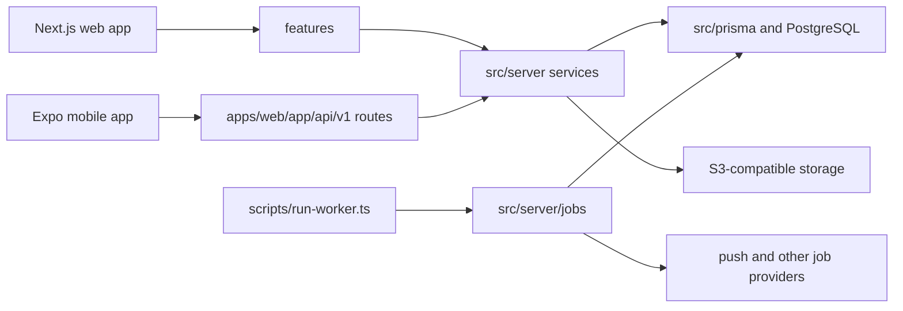
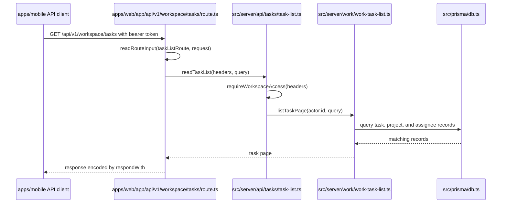

# Architecture

> Type: architecture · Status: current · Updated: 2026-10-29

Taskora is a team and client work-management system with a Next.js web application and an Expo mobile app. The web and mobile clients reach shared server-side domain logic, backed by PostgreSQL; the server also runs durable background jobs and integrates with object storage and external delivery providers.

## Context

The web app uses Next.js routes and feature adapters. The mobile app calls the web server's versioned API, and a separate worker processes queued jobs.

## Components

| Component | Path | Responsibility |
| --- | --- | --- |
| Web routes and layouts | `apps/web/app/` | Next.js pages, layouts, API route handlers, and application styles. |
| Web feature adapters | `features/` | Feature-specific UI, queries, Server Actions, and view models. |
| Domain services | `src/server/` | Authorization, validation, domain operations, and server integrations. |
| Mobile HTTP routes | `apps/web/app/api/v1/` | Versioned request handlers that parse route inputs and provide server services. |
| Mobile route definitions | `src/mobile-api/` | Shared route schemas used by the typed client and generated OpenAPI document. |
| Mobile client | `apps/mobile/` | Expo Router screens and the client-side API, session, and fixture layers. |
| Persistence | `src/prisma/`, `migrations/` | Prisma contract/schema sources and versioned PostgreSQL migrations. |
| Background worker | `scripts/run-worker.ts`, `src/server/jobs/` | Long-running job processor and the job handlers it provides. |

## Data flow

The following example traces a mobile task-list request through the concrete route, authorization, domain query, and database adapter.

## Key decisions

- The web feature layer adapts product-facing views and requests; domain operations are organized under `src/server/`. This boundary is visible in feature queries/actions and their service imports.
- Mobile route definitions in `src/mobile-api/` are shared by the generated typed client and OpenAPI output. `src/mobile-api/route-definition.ts` documents that route files and definitions are checked for drift.
- The mobile client defaults to live API mode. Hybrid mode uses fixtures only for operations listed as pending in `apps/mobile/src/api/pending-routes/`.
- No architecture decision records are currently documented; the bullets above describe the current code structure rather than claiming an ADR history.

## Where to start

1. `apps/web/app/api/v1/workspace/tasks/route.ts` — a representative mobile API handler.
2. `src/server/api/tasks/task-list.ts` — request authorization and handoff to domain logic.
3. `src/server/work/work-task-list.ts` — a domain query using the Prisma contract.
4. `apps/mobile/src/api/api-mode.ts` — live versus hybrid client behavior.
5. `scripts/run-worker.ts` — background worker startup and processing loop.
